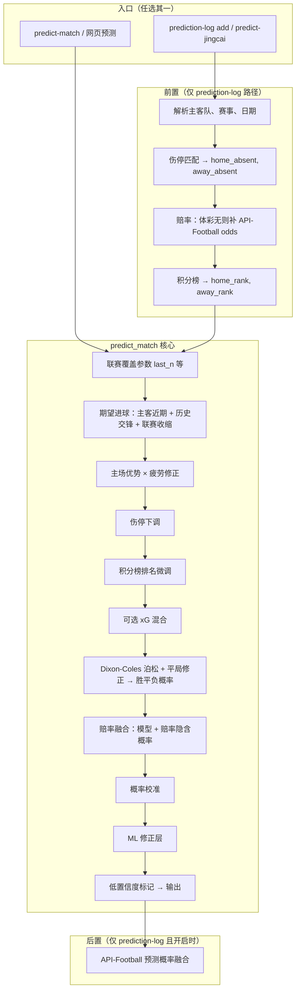
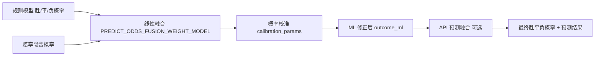

# 预测逻辑流程图

本文档用流程图概括当前「单场胜平负预测」的完整逻辑，便于对照代码与调参。

---

## 概率是怎么来的（简要公式与数据来源）

你看到的**主胜 / 平 / 客胜概率**是按下面步骤算出来的（代码在 `engine/predict.py`）。

### 第一步：期望进球 exp_home、exp_away

- **数据**：双方**近期已结束比赛**的比分（主队用主场近期、客队用客场近期；样本不足时用主客混合），只用到「谁进了几球」。
- **公式**（在 `_compute_exp_goals_one` 里）：
  - 主队期望进球 raw_exp_home = (主队近期场均进球 + 客队近期场均失球) / 2
  - 客队期望进球 raw_exp_away = (客队近期场均进球 + 主队近期场均失球) / 2
- **再做的调整**：
  - **历史交锋**：有交锋时按 `PREDICT_H2H_BLEND`（如 0.3）与上面结果融合。竞彩预测时若 **jingcai_match_analysis** 有体彩历史（`result_history_same_tournament` / `result_history_all`），会优先用该数据；否则用主库 matches 的 h2h。
  - **联赛收缩**：近期场次太少时，向**该联赛近期场均进球**收缩，避免被少数几场带偏。
  - **主场优势**：主队期望 × `PREDICT_HOME_ADVANTAGE`（如 1.05）。
  - **疲劳**：休息不足 N 天或未来 7 天赛程密，对该队期望 × 疲劳系数（如 0.95）。
  - **伤停**：缺阵人数（含关键球员权重）按配置下调该队期望。
  - **积分榜**：有主客排名时做小幅微调（排名好的一侧略升、另一侧略降）。
  - **可选 xG**：若开启且有近期 xG，与上面期望按比例混合。
- 多档 last_n（如 5 场 + 10 场）会分别算一次期望进球，再按配置权重（如 0.4×5场 + 0.6×10场）合成最终的 exp_home、exp_away。

所以：**概率的“根”是历史比分 → 场均进/失球 → 期望进球**，没有用盘口或博彩概率当输入（后面才会和赔率融合）。

### 第二步：从期望进球到胜/平/负概率（规则模型）

- **模型**：**Dixon–Coles 泊松**（在 `probs_from_exp_goals` 里）。
  - 假设主队进球数 ~ Poisson(exp_home)，客队 ~ Poisson(exp_away)，并用参数 rho（`PREDICT_DC_RHO`，如 -0.13）对 0-0、1-1 等低比分做相关性修正（tau 因子）。
  - 在 0～max_goals（如 8）的比分网格上，对每个 (i, j) 算 P(i,j) = Poisson(exp_home,i)×Poisson(exp_away,j)×tau(i,j)，然后：
    - 主胜概率 = 所有 i>j 的 P(i,j) 之和
    - 平局概率 = 所有 i=j 的 P(i,j) 之和
    - 客胜概率 = 所有 i<j 的 P(i,j) 之和
  - 再乘**平局修正**（势均力敌时抬平局）：平局概率 × (1 + draw_boost_coef × exp(-|exp_home - exp_away|))，然后三者重新归一化。
- 因此：**规则层概率 = 只由 exp_home、exp_away 和少量参数（rho、平局系数、max_goals）决定**，是“纯统计+泊松”的结果。

### 第三步：和赔率、校准、ML 的融合（可选）

- **赔率融合**（`PREDICT_USE_ODDS_FUSION=true` 且该场有胜平负赔率时）：
  - 从赔率反推隐含概率：主胜概率 ∝ 1/主胜赔率，同理平、客胜，再归一化。
  - 最终概率 = weight_model × 规则概率 + (1 - weight_model) × 赔率隐含概率，再归一化（`fuse_probs`）。
- **概率校准**（`PREDICT_USE_CALIBRATION=true` 且存在 `calibration_params.json`）：
  - 用历史「预测概率 vs 实际结果」拟合的 Platt 缩放（每档主/平/客可不同），对当前三个概率做缩放后再归一化，使概率更贴近实际发生频率。
- **ML 修正层**（`PREDICT_USE_OUTCOME_ML=true` 且已训练 `outcome_ml_model.joblib`）：
  - 以规则输出的期望进球、胜平负概率、last_n、联赛、排名差等为特征，用 GradientBoosting 再预测一次主/平/客概率，然后与上一步概率按 `PREDICT_OUTCOME_ML_WEIGHT` 混合并归一化。

所以：**你看到的最终概率 = 规则（期望进球→泊松）→ [赔率融合] → [校准] → [ML 修正]**，每一步都可关可开（见配置与流程图）。

### 单场推荐里的「让胜/让平/让负」概率

- **数据**：同一场的 exp_home、exp_away + **让球数**（来自赔率或竞彩）。
- **公式**（在 `db/self_improvement.py` 的 `_get_rq_probs`）：用 Poisson 近似算「主客进球差」的分布，再根据 (主-客)+让球数 把概率归到让胜/让平/让负三类。
- 单场推荐 = 在 **胜/平/负** 与 **让胜/让平/让负** 共 6 项里，取**概率最大**的一项；若该最大概率 ≥ 配置的 `SINGLE_REC_MIN_PROB`（如 0.50），则标为高置信。

**总结**：概率 = **历史比分 → 场均进/失球 → 期望进球 → Dixon-Coles 泊松（+平局修正）→ 可选赔率/校准/ML 融合**；没有用“盘口直接当概率”，只是可选地把赔率隐含概率与模型概率线性混合。

---

## 一、整体流程（Mermaid）



---

## 二、期望进球与概率（核心链）

```mermaid
flowchart LR
    subgraph 输入
        I1[主客队 ID / 赛事 / last_n]
    end

    subgraph 期望进球
        E1[主队主场近期 进球/失球]
        E2[客队客场近期 进球/失球]
        E3[样本不足 → 主客混合]
        E4[历史交锋融合 H2H_BLEND]
        E5[联赛收缩 → 向联赛平均靠拢]
        E6[主场优势 × 疲劳]
        E7[伤停下调]
        E8[积分榜微调]
    end

    subgraph 概率
        P1[exp_home, exp_away]
        P2[Dixon-Coles 泊松 + rho]
        P3[平局修正 draw_boost]
        P4[归一化 → 胜/平/负概率]
    end

    I1 --> E1 --> E2 --> E3 --> E4 --> E5 --> E6 --> E7 --> E8 --> P1 --> P2 --> P3 --> P4
```



---

## 三、概率后处理链（融合与修正）



---

## 四、关键配置与数据来源

| 环节 | 配置 / 数据 | 说明 |
|------|--------------|------|
| 联赛覆盖 | `data/predict_league_params.json` | 按赛事名覆盖 last_n、主场优势、平局系数、收缩样本数等 |
| 期望进球 | DB `matches` 近期场次 | 主队主场近期、客队客场近期；不足时主客混合 + 联赛收缩 |
| 历史交锋 | `PREDICT_H2H_BLEND` | 与近期期望进球按比例融合 |
| 伤停 | `data/injury_suspension.json` 或 API 伤停 | 按主客队+联赛匹配，缺阵人数折算下调 |
| 赔率 | 体彩 / `data/api_football_odds.json` | 无体彩时用 API 补全，转为隐含概率后融合 |
| 积分榜 | `data/api_football_standings.json` | 主客排名差 → 对期望进球微调 |
| 概率 | Dixon-Coles + `PREDICT_DRAW_BOOST_COEF` | 势均力敌时提高平局概率 |
| 赔率融合 | `PREDICT_ODDS_FUSION_WEIGHT_MODEL`（如 0.5） | 模型权重，1-该值=赔率权重 |
| 校准 | `data/calibration_params.json` | 历史拟合 Platt 缩放 |
| ML 修正 | `data/outcome_ml_model.joblib` | 规则输出作特征，GradientBoosting 预测后与规则概率混合 |
| API 预测 | `PREDICT_USE_API_PREDICTIONS` | 开启时在 prediction-log 路径再与 API-Football 预测概率融合 |

---

## 五、当前命中率与可评估样本

- **预测表总条数**：`predictions` 表/集合中的记录数（例如 6762 条）。
- **可参与评估的场次**：仅当该预测对应的比赛**已完赛且 `matches` 已填比分**时，才会被 `predict-eval` 统计；因此可评估数 ≤ 预测表条数。若可评估远小于总条数，可先做 backfill-predictions / 补比分（见 [提升准确率实操.md](提升准确率实操.md)#一可评估样本说明）再评估。

以下为运行 `predict-eval` 得到的**当前全量**示例（Mongo 全量评估），实际以本地输出为准。

### DB 预测表（predict-eval）

| 指标 | 当前数值（约 4086 场） |
|------|------------------------|
| 可评估场次 | 4086 场 |
| 胜平负猜对 | 1995/4086，**48.8%** |
| 精确比分命中 | 537/4086，13.1% |
| 期望进球 MAE（整体） | 0.901 |
| Brier 分数 | 0.394 |
| 平局召回率 | 27.4%（实际平 1063 场，预测为平 1035 场，猜对平 291 场） |

按赛事：UEFA Euro 72.5%、UEFA Women's Euro 71.0%、Copa America 59.4%；部分联赛按赛季拆解后存在多条（同名不同 id），整体已较调参前提升。

### prediction_log 复盘（recap）

与 DB 预测表样本集合可能不同（log 多来自竞彩/手动/auto-accumulate-log），命中率需分开看。运行 `python main.py prediction-log recap [--from-db] [--by-competition]` 查看。

### 查看最新命中率

```bash
python main.py predict-eval
python main.py predict-eval --by-competition
python main.py suggest-improvements
python main.py eval-all
```

### 提升准确率步骤

1. 增加可评估样本：`backfill-predictions`、补比赛比分后再 `predict-eval`。
2. 重训校准与 ML：`python main.py refresh-models`，再 `python main.py refresh-and-eval`。
3. 联赛级调参：按 `suggest-improvements` 提示改 `data/predict_league_params.json`，再 `repredict-history` + `predict-eval --by-competition`。
4. 详细步骤见 [提升准确率实操.md](提升准确率实操.md)。

---

## 六、prediction_log 复盘数据的用途与提高其命中率的影响

### 1. prediction_log 复盘（96 场）的数据有什么用？

**prediction_log** 里存的是「你实际记录下来的预测」：来自 `prediction-log add`、`predict-jingcai`、`daily-jingcai`、`auto-accumulate-log` 等，多数是竞彩/体彩相关或手动添加的场次。**复盘（recap）** 就是拿这批预测和实际比分对比，算命中率、MAE、按联赛/伤停拆解。

具体用途：

| 用途 | 说明 |
|------|------|
| **日常复盘** | 看「我记下来的这些场」预测准不准，哪些联赛/哪些场次偏差大，方便自己总结和调参。 |
| **概率校准** | `calibrate-probs` 默认会同时用 **DB + prediction_log** 里已填比分的条目，拟合 Platt 校准参数。所以这 96 场（及其预测概率）会参与生成 `calibration_params.json`，影响之后所有新预测的概率输出。 |
| **改进建议** | `suggest-improvements` 会读 recap 的**按联赛统计**，找出准确率明显低于整体的联赛，并建议在 `predict_league_params.json` 里调该联赛的平局系数、last_n 等。 |
| **伤停效果** | recap 会单独统计「有伤停数据的场次」里，原始预测 vs 伤停调整后预测的命中数，用来判断伤停是否在帮你提高命中率。 |

和 **DB 预测表（97 场）** 的区别：DB 的预测来自 `predict-match` 落库、通常和「list 里的比赛 / 网页复盘」绑定；prediction_log 是另一条线，更偏「竞彩/每日统计/手动记的场次」。两批样本不完全一样，所以两个命中率数字不能直接对比，但**用的是同一套预测逻辑**（同一套 config、同一套 ML/校准/赔率融合）。

### 2. 提高 prediction_log 复盘命中率会有什么影响？

若通过调参、补数据（赔率/积分榜/伤停）、或重训校准/ML，把 **prediction_log 复盘的命中率提高了**，会有这些影响：

| 影响 | 说明 |
|------|------|
| **你关心的场次更准** | 若这 96 场代表你真正在用的场景（如竞彩、每日要看的比赛），提高 recap 命中率 = 这类比赛的预测更准，直接有用。 |
| **校准更稳、泛化更好** | 校准拟合时用了 log 数据；log 里预测质量提高 → 拟合出的校准参数更靠谱 → 对**所有后续新预测**（包括 DB 和 log 新记的）都有益，概率更贴近实际。 |
| **联赛调参建议更可信** | suggest-improvements 里「弱联赛」和调参建议依赖 recap 的按联赛统计；recap 命中率提高往往意味着意甲/法甲等弱联赛也有改善，后续按建议微调会更有的放矢。 |
| **与 DB 指标的关系** | ML 修正层只从 **DB** 的 predictions+matches 训练，不直接用 log；但若你是通过改**同一套**全局/联赛参数提高的 log 命中率，同一套参数通常也会让 DB 或未来预测受益，因为底层模型是同一套。 |

**总结**：prediction_log 复盘既是你「实际记下来的那批比赛」的成绩单，又参与校准和改进建议；提高它的命中率，既能直接提升你关心的场次表现，也会让校准和联赛调参建议更可靠，并对后续所有新预测有正向影响。

### 3. 如何继续提高复盘命中率

已做与可做事项：

| 措施 | 说明 |
|------|------|
| **重算时与「新预测」同 pipeline** | `repredict-history` 里对 prediction_log 的重算已与 `append_prediction` 对齐：会按主客队+联赛补 **API-Football 赔率**、**积分榜排名**，再调用 `predict_match`。之后跑 `prediction-log recap` 得到的是「当前参数 + 有赔率/排名则融合」下的复盘。若历史场次在 `api_football_odds.json` / `api_football_standings.json` 中有数据，重算后复盘会更准。 |
| **为新场次开 API 预测融合** | 对新记的预测（`prediction-log add`、`predict-jingcai` 等）开启 `PREDICT_USE_API_PREDICTIONS=true`，可与 API-Football 的 predictions 概率融合，往往能提升当批命中率；复盘样本增多后整体 recap 命中率会逐步体现。 |
| **补历史赔率/积分榜** | 若 96 场多为过去日期，可对相关日期跑 `odds-api --date YYYY-MM-DD --merge`、`standings-api --season 年份`，再执行 `repredict-history`，使重算时用到赔率与排名。 |
| **调参注意** | 大幅降低平局系数（如全局 0.09 或意甲/法甲 0.03）可能把部分「平」翻成「主/客」，但易拉低 DB 命中率；建议以 `predict-eval` 与 `prediction-log recap` 一起看，在「不显著伤害 DB」前提下微调联赛平局系数或 last_n。 |
| **积累新样本** | 多跑 `auto-accumulate-log` 或每日竞彩预测并填比分，recap 样本增多后，校准与 suggest-improvements 的按联赛建议会更稳，有利于针对性调参再提高复盘命中率。 |
